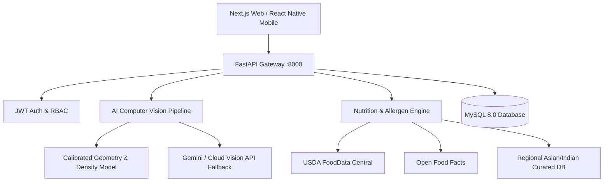

# TrackCal — Global AI Food Intelligence Platform
## Complete Architecture & Engineering Specification

### 1. Architectural Philosophy
TrackCal is an original, production-grade AI food intelligence and nutrition tracking platform inspired by the state-of-the-art in nutritional computer vision. It is engineered from scratch using modern web standards, microservice-ready backend APIs, and multi-source global nutrition datasets.

---

### 2. Decision on Tooling: REA (Reverse Engineer Anything)
**Status: NO — REA is NOT used in this project.**

- **Rationale**: REA is a binary analysis, decompilation, and reverse-engineering toolkit intended for inspecting compiled executables, Mach-O/PE binaries, memory traces, or native mobile APKs/IPAs.
- In this project, **TrackCal** is built as an **original, greenfield, clean-room SaaS and mobile platform**.
- All data schemas, database migrations, AI segmentation logic, APIs, and client interfaces are engineered using standard open web technologies (FastAPI, SQLAlchemy, Next.js, React Native, Tailwind CSS) and verified public nutrition databases (USDA FoodData Central, Open Food Facts).
- Reverse engineering closed-source proprietary binaries is neither needed nor appropriate for this project.

---

### 3. Backend Architecture (FastAPI & MySQL 8.0)
The backend is structured into clean domain routers:
- `routers/auth.py`: Token exchange, OAuth2 password flow, refresh tokens, password hashing with bcrypt.
- `routers/users.py`: User profile, dietary preferences (vegetarian, vegan, keto, halal), daily calorie & macro goals.
- `routers/foods.py`: Multi-source search, barcode lookups, micronutrient expansion, regional cuisine tagging.
- `routers/ai_scan.py`: Multi-component food scanning, bounding box parsing, portion calibration, and allergen flagging.
- `routers/meal_logs.py`: Journaling timeline, meal categorisation (breakfast, lunch, dinner, snack), and macro aggregations.
- `routers/nutrition.py`: Real-time analytics, daily/weekly deficit tracking, streak calculations, micronutrient adequacy.
- `routers/recipes.py`: Ingredient aggregation, cooked weight yield factors, custom user recipes.
- `routers/subscriptions.py`: Free vs. Pro tier management, billing hooks, receipt validation.
- `routers/support.py` & `community.py`: Support ticketing and crowdsourced regional food submissions.

---

### 4. Database Schema
Over 15 relational tables have been created and seeded in MySQL 8.0:
- `users`, `user_profiles`, `user_goals`
- `foods`, `food_nutrients`, `nutrient_definitions`, `allergens`
- `meal_logs`, `meal_items`, `food_images`
- `ai_scan_jobs`, `ai_predictions`, `food_corrections`
- `subscriptions`, `payments`, `audit_logs`

---

### 5. Frontend Dashboard (Next.js 16 + React 19)
The web client in `frontend/web` features:
- Interactive AI Vision Scanner simulator with live reticles, volumetric depth estimation, and laser scanning animation.
- Dynamic portion slider with real-time recalculation of calories, protein, carbohydrates, and fat.
- Explainable AI breakdown: plate coverage, density index, and allergen warning banners.
- Complete nutrition catalog with live search across 49+ pre-seeded global food items.
- Daily macro summary dashboard with visual progress indicators and meal logging journal.
